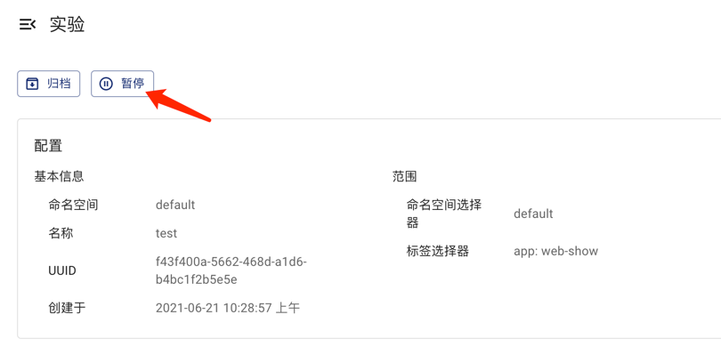
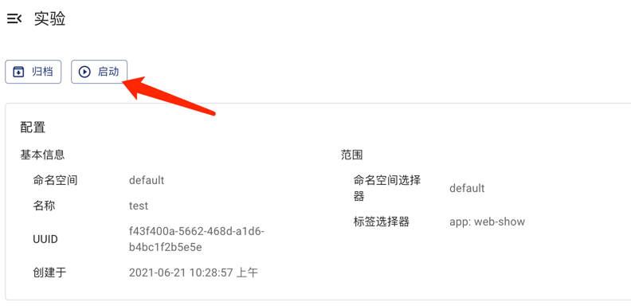
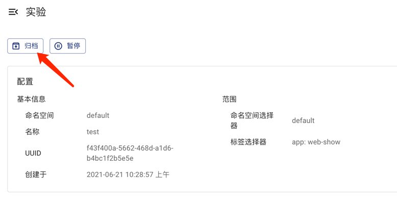

本文档介绍如何使用 Chaos Mesh 创建并运行混沌实验、查看混沌实验运行情况、暂停混沌实验、更新混沌实验以及清理混沌实验。

## 创建混沌实验

使用 Chaos Mesh，你可以创建以下两类混沌实验：

- 一次性混沌实验：是最小粒度的混沌实验。创建后，实验会立刻向测试目标注入已配置的故障。对于持续生效的故障，实验到期、暂停或删除时，Chaos Mesh 开始撤销已注入的故障。
- 定时或循环混沌实验：是可以定时运行或循环进行的混沌实验。创建时需要定义实验的时间调度规则。

:::info

对于持续生效的故障，可以通过 `duration` 设置实验的截止时间。Chaos Mesh 将实验对象的创建时间加上 `duration`，得到截止时间。

Chaos Mesh 采用创建时间是为了保证行为具有确定性。注入故障需要消耗时间，并且注入可能先失败、经过重试后才成功，因此故障真正生效的时间无法被精确确定。这会导致故障的实际生效时间可能比配置的 `duration` 略短。

:::

### 一次性混沌实验

要创建一次性混沌实验，你可以采用以下两种方式之一：

- 使用 Dashboard 新建混沌实验，然后点击**提交**按钮运行实验。更多详细步骤，请参阅具体的混沌实验类型文档。
- 使用 YAML 文件定义混沌实验，然后使用 `kubectl` 命令创建并运行实验。

要使用 YAML 文件方式定义混沌实验并运行实验，请完成以下操作：

1. 新建一个 YAML 文件用于定义混沌实验。在此 YAML 文件中，依据混沌实验类型，添加相应的配置参数。

   以模拟网络故障为例，新建一个包含如下配置示例的 `network-delay.yaml` 文件。

   ```yaml
   apiVersion: chaos-mesh.org/v1alpha1
   kind: NetworkChaos
   metadata:
     name: network-delay
   spec:
     action: delay # the specific chaos action to inject
     mode: one # the mode to run chaos action; supported modes are one/all/fixed/fixed-percent/random-max-percent
     selector: # pods where to inject chaos actions
       namespaces:
         - default
       labelSelectors:
         'app': 'web-show' # the label of the pod for chaos injection
     delay:
       latency: '10ms'
     duration: '12s'
   ```

   示例 YAML 文件中定义了一个持续 `12s` 的网络延迟故障，实验目标是 `default namespace` 下带有 `"app": "web-show"` 标签的应用。关于网络故障的更多配置信息，请参考[模拟网络故障](simulate-network-chaos-on-kubernetes.md)。

   如果希望网络延迟持续到暂停或删除实验，请省略此 YAML 中的 `spec.duration`，直接创建 `NetworkChaos` 资源。

2. 使用 `kubectl apply -f` 命令创建并运行此混沌实验：

   ```yaml
   kubectl apply -f network-delay.yaml
   ```

3. 混沌实验开始后，如需检查混沌实验的运行情况，请使用 `kubectl describe` 命令查看此混沌实验对象的 `status` 或者 `event`。

   ```yaml
   kubectl describe networkchaos network-delay
   ```

   要了解详细的运行结果检查步骤，请参考[检查实验结果](inspect-chaos-experiments.md)。

### 定时或循环混沌实验

Chaos Mesh 提供 `Schedule` 对象，帮助创建定时混沌实验和循环混沌实验。

要创建定时或循环混沌实验，请进行以下操作：

1. 新建一个 YAML 文件用于定义混沌实验。在此 YAML 文件中，需要配置 `Schedule` 相关参数用于定义具体的时间调度规则，然后依据混沌实验类型配置故障相关参数。

   以模拟一个定时的网络故障为例，新建一个包含如下配置示例的 `schedule-delay-example.yaml` 文件。

   ```yaml
   apiVersion: chaos-mesh.org/v1alpha1
   kind: Schedule
   metadata:
     name: schedule-delay-example
   spec:
     schedule: '5 * * * *'
     historyLimit: 2
     concurrencyPolicy: 'Allow'
     type: 'NetworkChaos'
     networkChaos:
       action: delay
       mode: one
       selector:
         namespaces:
           - default
         labelSelectors:
           'app': 'web-show'
       delay:
         latency: '10ms'
       duration: '12s'
   ```

   示例 YAML 文件中定义了一个可以在每个小时的第 5 分钟自动运行的网络延迟故障。更详细的调度规则定义，请参考[定义调度规则](define-scheduling-rules.md)。

2. 使用 `kubectl apply -f` 命令创建并运行混沌实验。

   ```yaml
   kubectl apply -f schedule-delay-example.yaml
   ```

3. 混沌实验开始后，如需检查混沌实验的运行情况，请使用 kubectl describe 命令查看此混沌实验对象的 status 或者 event。

   ```yaml
   kubectl describe networkchaos schedule-delay-example
   ```

   要了解详细的运行结果检查步骤，请参考[检查实验结果](inspect-chaos-experiments.md)。

## 暂停混沌实验

暂停正在运行的实验时，Chaos Mesh 开始撤销已注入的故障。暂停期间的时间也计入 `duration`，实验仍按原定时间到期。到期前恢复实验，Chaos Mesh 可以在剩余时间内重新注入故障。到期后恢复，实验仍处于停止状态。如果省略 `duration`，只要实验对象还存在，就可以随时恢复实验。

例如，创建一个配置了 `duration: '60s'` 的 `NetworkChaos` 实验，并在创建后第 20 秒暂停。如果控制器在第 40 秒处理恢复操作，距离截止时间还有 20 秒。如果控制器在截止时间之后处理恢复操作，实验的期望状态仍为停止。

`pod-kill` 和 `container-kill` 等只执行一次的动作会忽略暂停和 `duration` 设置。

### 使用命令暂停或者恢复混沌实验

在混沌实验运行过程中，如需暂停混沌实验，可以使用命令设置暂停注解。

例如，要暂停默认命名空间中一个名为 `network-delay` 的混沌实验，你可以使用以下命令：

```yaml
kubectl annotate networkchaos network-delay experiment.chaos-mesh.org/pause=true
```

要恢复实验，请移除暂停注解：

```yaml
kubectl annotate networkchaos network-delay experiment.chaos-mesh.org/pause-
```

### 使用 Dashboard 暂停或者恢复混沌实验

如果你想通过 Dashboard 暂停或者恢复混沌实验，找到对应的混沌实验点击**暂停**或者**启动**按钮即可。





## 更新混沌实验

### 使用命令更新混沌实验

目前混沌实验的 `Spec` 字段不允许被更新。

更多细节，请参见对应的 [GitHub issue](https://github.com/chaos-mesh/chaos-mesh/issues/2227)。

### 使用 Dashboard 更新混沌实验

由于目前混沌实验的 `Spec` 字段不允许被更新，所以 Dashboard 暂不支持更新混沌实验。

## 清理混沌实验

### 使用命令删除混沌实验

结束混沌实验后，可以通过 `kubectl delete` 命令删除混沌实验。混沌实验删除后，注入的故障会被立刻恢复：

```yaml
kubectl delete -f network-delay.yaml
# or delete the chaos object directly
kubectl delete networkchaos network-delay
```

如果删除操作因为某些目标对象的故障行为无法恢复而被阻塞，请参考[清理混沌实验](clean-up-chaos-experiments.md)了解强制清理的方法。

### 使用 Dashboard 删除混沌实验

如果你想要在 Dashboard 上删除混沌实验并归档到历史记录汇总，可以点击对应混沌实验的**归档**按钮。


